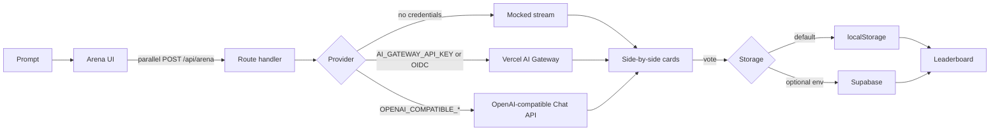

# LLM Arena

Send one prompt to several language models at once. Their answers stream side by side with time to first token, total latency, token counts, and an estimated cost. Pick the answer you would actually use, then see a small leaderboard.

With no API keys, the app runs in **demo mode**: each model still streams, but the text is a local mock. Nothing is sent to a provider.



## Quickstart

Requires Node.js 22 or newer.

```bash
npm install
npm run dev
```

Open [http://localhost:3000](http://localhost:3000). Type a prompt, or use one of the examples, and press **Compare**. Three cards stream. When a card finishes, choose **Prefer this answer**. The [leaderboard](http://localhost:3000/leaderboard) ranks models by wins on this browser.

`Ctrl` or `Cmd` + `Enter` also submits the prompt.

## How a round works

1. The browser sends the same prompt to `POST /api/arena` once per enabled model, in parallel.
2. Each response is newline-delimited JSON: text deltas, then a `done` event with latency, tokens, and cost.
3. A vote is stored under `llm-arena.votes.v1` in `localStorage`. Voting again on the same round replaces the earlier choice.
4. Win rate is wins divided by the rounds that model was part of.

Demo answers are deterministic templates. They are there so the interface, the vote, and the leaderboard work with no network. They are not model output.

Live answers use the [Vercel AI SDK](https://ai-sdk.dev) `streamText`. Gateway models are `provider/model` strings through `gateway()`. An OpenAI-compatible base URL uses Chat Completions via `@ai-sdk/openai`, so the endpoint does not need the Responses API.

## Configuration

Copy the example file and edit it. Real keys stay in `.env.local` or the host's env settings. `.env*` is gitignored except `.env.example`.

```bash
cp .env.example .env.local
```

| Variable | Purpose |
| --- | --- |
| `ARENA_PROVIDER` | `auto` (default), `demo`, `gateway`, or `openai-compatible`. |
| `ARENA_MODELS` | Comma-separated model ids. At most 6. |
| `ARENA_PRICING` | Optional JSON of USD per 1M tokens, keyed by model id. |
| `ARENA_MAX_OUTPUT_TOKENS` | Cap for a live answer. Default 800. |
| `AI_GATEWAY_API_KEY` | Vercel AI Gateway key. Turns `auto` into gateway mode. |
| `OPENAI_COMPATIBLE_BASE_URL` | Chat Completions base URL, for example `https://ai-gateway.vercel.sh/v1`. |
| `OPENAI_COMPATIBLE_API_KEY` | Key for that base URL. |
| `SUPABASE_URL` | Optional. Both Supabase vars are required to leave `localStorage`. |
| `SUPABASE_SERVICE_ROLE_KEY` | Server-only key for the optional shared board. |

`auto` stays in demo when nothing is set. A Vercel deployment always receives `VERCEL_OIDC_TOKEN`; that alone does not leave demo, so a public deploy does not call models until you opt in.

Built-in prices are a snapshot of [AI Gateway list prices](https://ai-gateway.vercel.sh/v1/models) (USD per token, shown here per million). They cover the default models and a few neighbors. Anything else shows no cost until you add `ARENA_PRICING`. The figure is an estimate, not a bill. Demo mode labels tokens as estimated (`ceil(characters / 4)`). Live mode prefers the provider's usage when it arrives.

### Gateway

```bash
ARENA_PROVIDER=gateway
AI_GATEWAY_API_KEY=your_key_here
ARENA_MODELS=openai/gpt-5-mini,anthropic/claude-haiku-5.5,google/gemini-3.8-flash
```

On Vercel you can omit the key and rely on OIDC. Set `ARENA_PROVIDER=gateway` so the app actually uses it. Create a key from the [AI Gateway API keys](https://vercel.com/d?to=%2F%5Bteam%5D%2F%7E%2Fai-gateway%2Fapi-keys&title=AI+Gateway+API+Keys) page for local runs. Model ids must come from the live catalog, not from memory.

### OpenAI-compatible endpoint

```bash
ARENA_PROVIDER=openai-compatible
OPENAI_COMPATIBLE_BASE_URL=https://ai-gateway.vercel.sh/v1
OPENAI_COMPATIBLE_API_KEY=your_key_here
```

The same shape works for any server that implements `POST /chat/completions`. Model ids are sent through as configured. Pointing this at the gateway still uses gateway model ids such as `openai/gpt-5-mini`.

### Optional Supabase leaderboard

Votes stay in the browser unless both `SUPABASE_URL` and `SUPABASE_SERVICE_ROLE_KEY` are set. The service role is read only on the server. Apply [`supabase/schema.sql`](supabase/schema.sql) in your project before enabling it. A changed vote upserts on `comparison_id`. This repo does not create a Supabase project for you.

If the shared board is down, the leaderboard falls back to votes on this device.

## Deploy on Vercel

The app is a Next.js App Router project. No custom build command is required.

1. Push the repository to GitHub.
2. In Vercel, import the repository. The framework preset is Next.js.
3. Leave the AI variables empty for a demo deployment. Comparisons stream mocked answers and votes stay in each browser.
4. For live models, set `ARENA_PROVIDER` to `gateway` (OIDC on Vercel, or `AI_GATEWAY_API_KEY`) or to `openai-compatible` with the two `OPENAI_COMPATIBLE_*` variables. Set `ARENA_MODELS` if you want a different set than the defaults.
5. Deploy, open the site, and run one prompt. Each card should stream, then show latency, tokens, and a cost.

Streaming uses the Node.js runtime. Do not set the route to the Edge runtime.

## Scripts

| Command | What it does |
| --- | --- |
| `npm run dev` | Local dev server |
| `npm run lint` | ESLint |
| `npm run typecheck` | Route types, then `tsc --noEmit` |
| `npm test` | Unit tests for config, pricing, votes, demo streams, and the leaderboard |
| `npm run build` | Production build |

GitHub Actions runs lint, typecheck, test, and build on pull requests and on pushes to `main`.

## License

[MIT](LICENSE)
